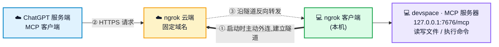
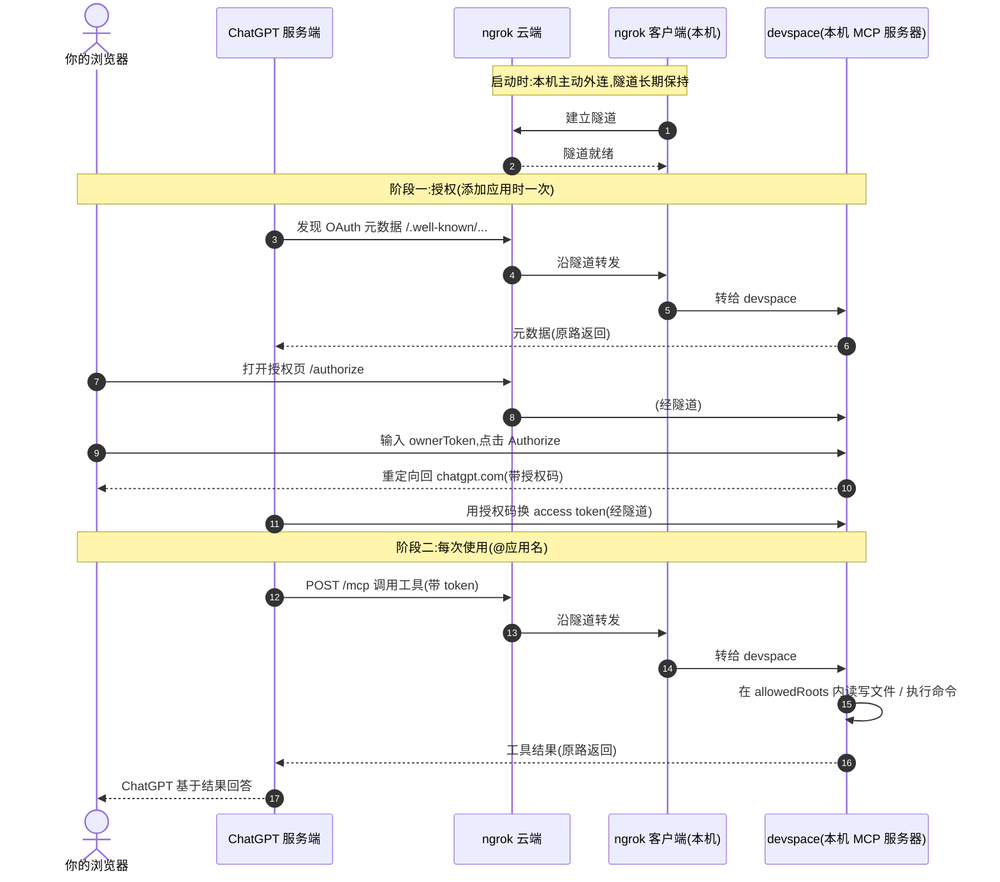
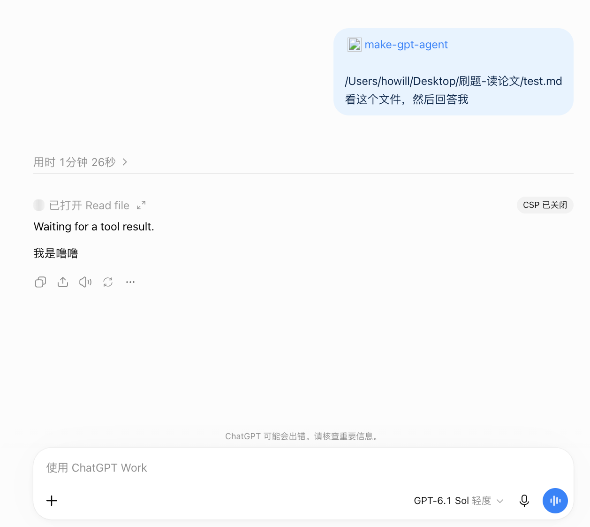

<a id="top"></a>

<div align="center">
  <h1>make-chatgpt-agent</h1>
</div>

<div align="center">

[](https://github.com/Waishnav/devspace)&#160;
[](https://ngrok.com/)&#160;
[](https://modelcontextprotocol.io/)&#160;
[](https://nodejs.org/)&#160;
[](LICENSE)&#160;
[](https://github.com/HOWILLMAKEIT/make-chatgpt-agent)

**让 ChatGPT 网页端通过 MCP 读写本机的代码仓库**

[工作原理](#工作原理) | [前置条件](#前置条件) | [配置步骤](#配置步骤) | [注册命令](#注册-shell-命令可选) | [使用](#使用) | [踩过的坑](#踩过的坑)

</div>

方案由 [devspace](https://github.com/Waishnav/devspace)(npm 包 `@waishnav/devspace`)和 ngrok 隧道组成,不含自研服务端。

> **让 agent 帮你配置**:把本仓库交给你的 agent(Claude Code、Codex 等),对它说"读 AGENTS.md,帮我配置"即可。AGENTS.md 写明了它能做什么、哪些步骤必须由你亲自完成(ngrok 令牌、ChatGPT 授权等)以及常见的坑。

## 工作原理

**MCP 服务器就是本机上的 devspace**,监听 `127.0.0.1:7676`,入口是 `/mcp`(Streamable HTTP,自带 OAuth)。ChatGPT 是 MCP 客户端。

问题在于:发请求的不是你的浏览器,而是 **OpenAI 的云端服务器**,它访问不到你电脑上的 `127.0.0.1`。ngrok 解决这件事:

- 本机的 ngrok 客户端**主动向外**连到 ngrok 云端,建立一条长连接隧道。你的电脑不需要开放端口,也不需要公网 IP。
- ChatGPT 访问你的固定域名时,请求先到 ngrok 云端,再沿这条已建立的隧道**反向送回**本机,转给 devspace。响应原路返回。



☁️ 为云端,💻 为你的电脑。响应沿同一条路径原路返回。工具只能访问 `allowedRoots` 下的目录。

一次完整交互的时序(两个阶段:授权一次,之后每次对话都是工具调用):



所以通信是**双向**的,但**连接只由本机发起一次**:隧道建好后,请求和响应都在这条连接里往返。隧道断了(关 ngrok、断网、电脑休眠),ChatGPT 就找不到你的 MCP 服务器。

<p align="right"><a href="#top">🔝 Back to top</a></p>

## 前置条件

- Node(devspace 1.0.8 要求 >=20.12 <27)和 Git。
- 能添加自定义 MCP 的 ChatGPT 账号,免费 ngrok 账号。
- macOS / Linux 直接可用。Windows 需要 Git Bash 或 WSL(devspace 的 shell 工具依赖 bash,纯 PowerShell 和 cmd 不支持,此条来自 devspace 文档,我未在 Windows 上验证)。

<p align="right"><a href="#top">🔝 Back to top</a></p>

## 配置步骤

**1. 安装并初始化 devspace**

```bash
npm install -g @waishnav/devspace
devspace init        # 场景选 ChatGPT
devspace doctor
```

- `init` 会随机生成 `ownerToken`,保存在 `~/.devspace/auth.json`,授权时需要输入。请勿外传,重置用 `devspace init --force`。
- 编辑 `~/.devspace/config.json`,确保包含以下两项(其余字段保持不变):

  ```json
  {
    "allowedRoots": ["/你的项目绝对路径"],
    "subagents": { "enabled": false }
  }
  ```

  不写 `allowedRoots` 时,devspace 会使用启动时的当前目录。
- `doctor` 应显示正确的 `Allowed roots` 和 `Subagents: disabled`。

**2. 安装 ngrok 并领取固定域名**

```bash
brew install --cask ngrok          # Windows: winget install ngrok.ngrok
ngrok config add-authtoken <你的token>     # 在自己的终端执行,不要贴到聊天里
```

在 https://dashboard.ngrok.com 的 Domains 页面领取免费的固定域名(形如 `xxx.ngrok-free.dev`),重启后不会变。

**3. 启动**

```bash
NGROK_DOMAIN=xxx.ngrok-free.dev node scripts/agent.mjs start        # Windows PowerShell: $env:NGROK_DOMAIN="xxx.ngrok-free.dev"; node scripts/agent.mjs start
```

脚本会设置 `publicBaseUrl`,并在后台启动 ngrok(自动去掉代理环境变量)和 `devspace serve`,进程号保存在 `~/.make-chatgpt-agent/pids.json`,日志在同目录下。停止用 `node scripts/agent.mjs stop`。

**4. 验证**

- `curl -i http://127.0.0.1:7676/mcp` 返回 401 即为正常。浏览器直接打开 `/mcp` 会是空白页,这也是正常的。
- `https://<域名>/.well-known/oauth-protected-resource/mcp` 应返回包含 `"resource_name":"DevSpace"` 的 JSON。可用 check-host.net 的海外节点验证公网可达。

**5. 在 ChatGPT 添加**

1. 打开 `https://chatgpt.com/plugins`,Add custom MCP server。
2. Server URL 填 `https://<域名>/mcp`,认证选 OAuth。
3. 在跳转的授权页输入 `ownerToken`,点击 Authorize。ngrok 免费版可能先显示一个提示页,点继续即可。
4. 新建对话,输入 `@` 并选择该应用。

<p align="right"><a href="#top">🔝 Back to top</a></p>

## 注册 shell 命令(可选)

把函数加到 shell 配置里,修改项目路径和域名。

**zsh / bash**(`~/.zshrc` 或 `~/.bashrc`):

```bash
make-chatgpt-agent-start() {
  NGROK_DOMAIN=<你的域名>.ngrok-free.dev node <项目绝对路径>/scripts/agent.mjs start
}
make-chatgpt-agent-stop() {
  node <项目绝对路径>/scripts/agent.mjs stop
}
```

保存后执行 `source ~/.zshrc`(或新开终端)。

**Windows PowerShell**(`notepad $PROFILE` 打开配置文件):

```powershell
function make-chatgpt-agent-start {
  $env:NGROK_DOMAIN = "<你的域名>.ngrok-free.dev"
  node "<项目绝对路径>\scripts\agent.mjs" start
}
function make-chatgpt-agent-stop {
  node "<项目绝对路径>\scripts\agent.mjs" stop
}
```

之后在任意目录运行 `make-chatgpt-agent-start` 启动、`make-chatgpt-agent-stop` 停止,电脑重启后同样如此。启动前请确保代理软件已运行。

<p align="right"><a href="#top">🔝 Back to top</a></p>

## 使用

在对话里输入 `@make-chatgpt-agent`(即你在 ChatGPT 里给这个应用起的名字),然后直接提需求即可,ChatGPT 会自行调用本机工具。



- 只能访问 `allowedRoots` 下的路径。
- 写文件和执行命令时 ChatGPT 会请你确认,请检查路径和命令后再批准。
- 服务重启后会话失效,再发一条消息即可重新连接。
- 用完后运行 `make-chatgpt-agent-stop`。电脑重启后用 `make-chatgpt-agent-start` 重新启动。

<p align="right"><a href="#top">🔝 Back to top</a></p>

## 踩过的坑

- **ngrok 报 `ERR_NGROK_9009`**:免费版不支持 HTTP 代理,只要 shell 里设了 `http_proxy` 等变量就会被拒绝。启动时用 `env -u` 去掉这些变量即可(脚本已处理)。
- **allowed roots 变成启动目录**:配置中没有 `allowedRoots` 时,在 `~/.devspace` 下运行 `doctor`,显示的是 `~/.devspace`。
- **Tailscale Funnel 在国内网络下不可用**:实测中,先是登录被代理的 fake-ip 阻断(需把 `+.tailscale.com`、`+.tailscale.io` 加入 DNS 的 fake-ip 过滤);登录成功后,Funnel 域名的公网 A 记录只存在了几分钟,随后权威 DNS 返回空结果,原因未查明,ChatGPT 一直报"无法发现 OAuth 设置"。改用 ngrok 后,四个海外节点和本机均返回 HTTP 200。
- **本机自测不可靠**:代理的 fake-ip 和 MagicDNS 会使本机 curl 的结果失真,验证公网可达性请使用海外节点。

<p align="right"><a href="#top">🔝 Back to top</a></p>

## 致谢

- [devspace](https://github.com/Waishnav/devspace) by Waishnav

<p align="right"><a href="#top">🔝 Back to top</a></p>
